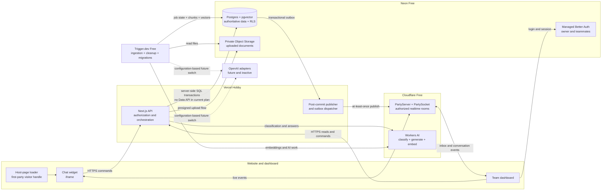
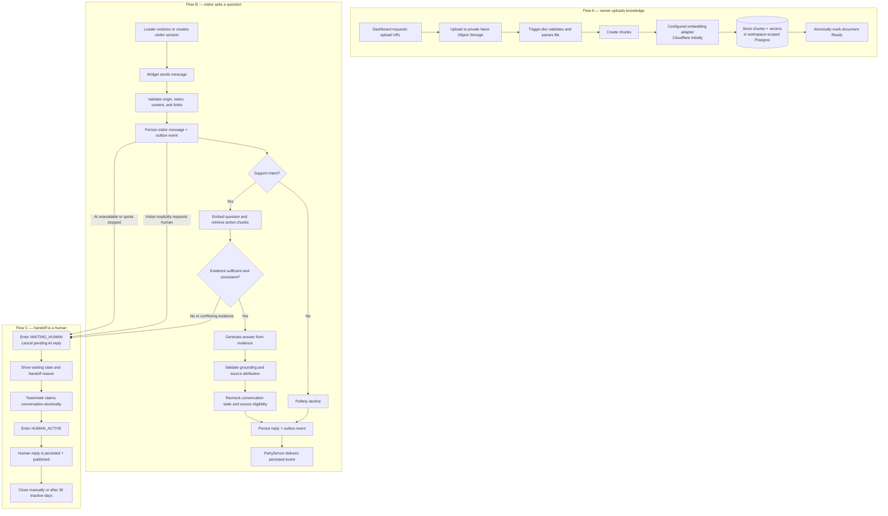

# PopSage v1 — architecture and workflow diagrams

Status: Updated planning view · 3 November 2026

These diagrams summarize the approved design. They intentionally omit detailed retention, migration, quota, audit, and failure-policy mechanics documented in the PRDs and ADRs.

Downloadable exports: [system architecture](./popsage-architecture.svg) · [product workflow](./popsage-workflow.svg)

## System architecture

Key interpretation:

- Postgres is authoritative. PartyServer delivers live events but is not the transcript store.
- Next.js and Trigger.dev use server-side Postgres access; Neon Data API is not part of the current plan.
- Cloudflare Workers AI is active initially. Separate OpenAI adapters exist in the future design but cannot activate automatically.
- Application authorization and Postgres RLS both enforce workspace isolation.

## Product workflow

The original A/B/C product logic remains intact. The updated workflow adds durable persistence before realtime delivery, configurable AI providers, evidence validation, explicit cancellation during handoff, and reliable background processing.

## Main changes from the original diagrams

| Original label or implication | Updated design |
|---|---|
| PartyKit | PartyServer + PartySocket on Cloudflare Workers and Durable Objects |
| OpenAI always handles AI and embeddings | Cloudflare Workers AI initially; independent future OpenAI adapters |
| Generic Functions | Trigger.dev durable jobs for ingestion, cleanup, and migrations |
| Generic Auth | Neon Managed Better Auth plus PopSage workspace authorization |
| Generic Object Storage | Private Neon Object Storage with scoped presigned operations |
| Publish directly to realtime | Persist state and outbox event first, then publish and retry safely |
| AI streams unchecked output | Validate the complete grounded answer before exposing factual content |
| AI stops after human takeover | AI stops as soon as the conversation enters `WAITING_HUMAN` |
| Database access unspecified | Server-side Postgres access with application authorization and RLS; no Data API currently |
