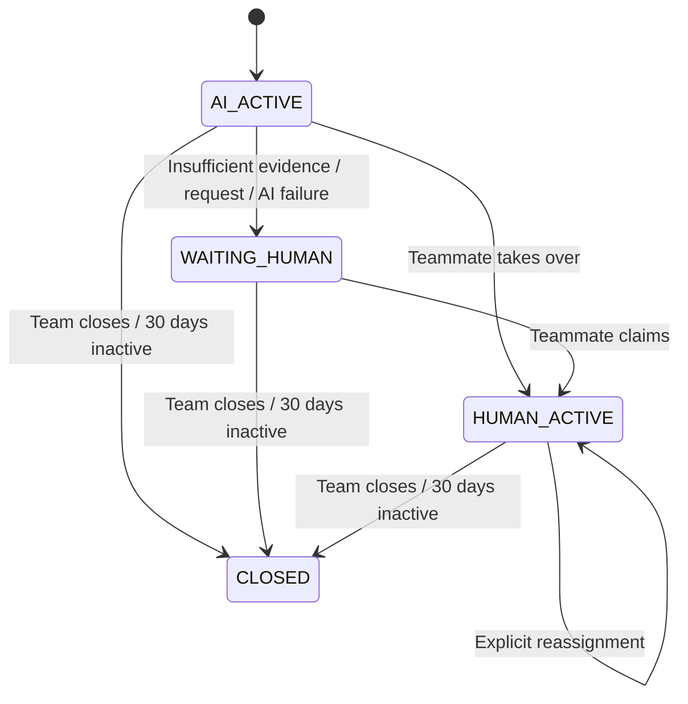

# PRD 03 — Grounded AI support and human handoff

Status: Product baseline approved · Priority: v1 required · Covers: Flows B and C · Related: [Product brief](README.md)

Initial evaluation uses fictional businesses and approved test documents. The project owner tests the expected answers; real business representatives must validate answers before a customer pilot. Free-tier exhaustion must fall back honestly to human chat or an unavailable state, never activate paid AI automatically.

## Problem and outcome

Visitors need accurate business support, and businesses need an assistant that does not guess, answer arbitrary requests, or compete with their human team. Success means supported questions receive useful, evidence-based answers while unrelated requests are declined and unresolved support needs reach a person with context intact.

## Scope and behavioral policy

The AI answers from the current workspace’s Ready knowledge only. It does not browse the web, use general model knowledge as evidence, execute document instructions, or take account/business actions. Account-specific requests go to humans; no customer-account lookup is available in v1. Uploaded knowledge must be suitable for disclosure to any visitor. It identifies itself as AI. Human-written responses are labeled separately.

“On-topic” means a plausible support request for this business, not merely a question with a matching document. A missing refund policy is a reason for handoff, not an off-topic refusal. Approved setup requires a short business/support-scope description so an empty knowledge base does not make scope classification meaningless.

| Incoming message | Expected behavior |
|---|---|
| Supported business question | Retrieve active workspace knowledge; answer only supported claims. |
| Relevant question with no sufficient evidence | Explain the limitation and enter the human waiting queue. |
| Conflicting or ambiguous evidence | Do not choose an unsupported policy; hand off. |
| Clearly unrelated request, such as a poem or unrelated arithmetic | Politely decline and invite a business-support question; skip embedding/retrieval/answer generation. |
| Explicit request for a person | Enter the human waiting queue immediately, including when knowledge could answer. |
| Greeting, thanks, or short contextual follow-up | Handle conversational context; do not misclassify routine dialogue as abuse. Factual claims still require evidence. |
| Unclear question | Approved: ask one concise clarifying question; if still unclear, hand off. |
| Mixed support and unrelated request | Answer the supported support portion; decline the unrelated portion. If the support portion lacks evidence, hand off. |
| Instructions to reveal secrets or ignore rules | Do not obey; decline or handle the legitimate support portion without exposing private data or internal prompts. |

Examples are contextual: arithmetic may be valid support for a calculator business. Classification uses the business scope and conversation context rather than a universal keyword blacklist.

## Flow B — visitor asks a question

1. Server authenticates the visitor, validates content and limits, and persists the accepted message.
2. Route according to conversation state. In waiting/human-active states, deliver to humans without starting an AI answer. In AI-active state, classify every incoming visitor message before the answer pipeline. A dedicated human-request control can directly trigger handoff.
3. For eligible support questions, embed the query through the configured embedding provider (initially Cloudflare Workers AI; OpenAI adapter designed for future use) and retrieve relevant Ready chunks within the authorized workspace.
4. Assess whether the evidence supports an answer. “Confident” is not the model’s self-reported percentage: evidence sufficiency, relevance, conflicts, and answer grounding must be evaluated against labeled examples.
5. Generate a bounded answer from that evidence and attach source identifiers for team review. Approved: visitor-facing citations are optional in v1; source traceability for reviewers is required.
6. Recheck conversation ownership/state and source eligibility before committing an answer. Persist the result and publish through PartyServer/PartySocket on Cloudflare to the widget and dashboard. Postgres remains authoritative if live publication fails.

The supplied flow shows streaming. Approved v1 safety interpretation: validate the complete answer before exposing its factual content, then deliver the validated answer incrementally if desired. Raw model tokens must not appear before the grounding decision. Genuine token-by-token generation streaming is an explicit later tradeoff requiring a separate validation strategy.

## Flow C — human handoff

Approved state contract:

An off-topic decline leaves the conversation AI_ACTIVE. Closing, inactivity/abandonment, expiry, and new-conversation behavior follow PRD 01. Inactivity closure invalidates pending AI work just as explicit closure does. If AI is disabled or no knowledge is Ready, approved default is to start the visitor’s first support request in WAITING_HUMAN. There is no automatic return from human ownership to AI in v1.

AI replies stop as soon as WAITING_HUMAN begins, before a person claims. The visitor receives one transition acknowledgment, sees waiting status, and may continue sending messages. The human receives the full transcript and structured reason: visitor request, insufficient evidence, conflicting evidence, unresolved ambiguity, or AI failure. Do not fabricate availability or a response deadline.

## Functional requirements

| ID | Requirement |
|---|---|
| AI-01 | Classify every eligible AI-active visitor message before answering. Keep intent classification distinct from evidence availability; uncertain classification must not authorize an arbitrary answer. |
| AI-02 | Retrieve only active, Ready knowledge for the authorized workspace. Conversation history helps interpret questions but is not authoritative evidence for business policy. |
| AI-03 | Require support for every material factual claim. Missing, contradictory, or inadequate evidence triggers handoff; no invented policies, links, promises, or account details. |
| AI-04 | Treat visitor messages and retrieved documents as untrusted content, not permission to change the assistant’s rules. The classifier is one control, not a guarantee against prompt injection. |
| AI-05 | Enforce request-size, request-rate, concurrency, and per-workspace AI usage limits server-side. Budget exhaustion degrades to human support with an honest status; no billing UI is required. Reject abusive over-limit submissions before expensive work. |
| AI-06 | Bound classifier, embedding, retrieval, and generation duration/retries. On exhaustion or provider failure, retain the visitor message and queue a handoff instead of leaving a permanent typing indicator. |
| AI-07 | A handoff or takeover must invalidate any pending AI response. Late workers/events cannot append AI replies after the state change. Persist and publish the transition consistently. |
| AI-08 | Preserve visitor-message order and prevent duplicate AI replies under retries. Approved: a newer visitor turn invalidates any uncommitted response and prompts a response using the latest ordered context. Bound restarts so rapid input cannot create unlimited calls. |
| AI-09 | Record decision outcome, reason, model/configuration version, source IDs, latency, token usage, and failure type for evaluation. Do not store hidden reasoning or put raw conversation text into general telemetry by default. |
| AI-10 | Provide a workspace AI on/off control for the owner. Switching off cancels pending responses and queues active AI conversations for humans; switching on affects new conversations only in v1. |

## Provider readiness — approved Q16

Cloudflare Workers AI is the initial active provider for classification, generation, and embeddings. Design separate Cloudflare and OpenAI adapters implementing provider-independent interfaces for all three capabilities from the outset. Select provider/model independently per capability through server-side environment or application configuration. Mixed combinations must not require business-logic changes. Exact models remain evaluation candidates; approving the provider does not establish model quality or authorize paid use.

Initial Cloudflare evaluation candidates are `@cf/meta/llama-3.1-8b-instruct-fp8` for classification and generation and `@cf/baai/bge-small-en-v1.5` for English embeddings. These identifiers are configuration, not permanent architecture. Do not activate them for application use until the common quality, retrieval, latency, and free-quota evaluation passes. A different eligible free Cloudflare model may replace either candidate through the same contracts without changing business logic.

Follow [ADR 0005](../adr/0005-independent-ai-providers.md) for normalized contracts, configuration validation, operation snapshots, and embedding migration. Retrieval, tenant authorization, source attribution, grounding checks, and handoff remain application-owned requirements for every adapter. Provider failure never relaxes evidence requirements or automatically selects OpenAI. An installed adapter or configured API key is not paid-use authorization.

| ID | Requirement |
|---|---|
| AI-11 | Separate classification, generation, and embedding interfaces; design Cloudflare and OpenAI adapters for each. Keep provider SDK payloads out of business logic. |
| AI-12 | Configure each capability independently, defaulting to Cloudflare. Validate supported provider/model combinations; snapshot effective configuration per operation and record it with outcomes. Inactive adapters make no calls and need no credentials. |
| AI-13 | Normalize outputs and errors. Invalid intent/output must not be interpreted as a safe answer; unknown usage is not zero cost. Preserve bounded retries, source checks, and tenant scope across providers. |
| AI-14 | Refuse incompatible query/index embedding profiles, including same-dimension models from different embedding spaces. An embedding configuration change requires explicit re-embedding and validated index cutover, not silent reuse. |
| AI-15 | Remain within free quotas by default. Never automatically activate billing, use paid fallback, or run paid integration tests. Require explicit paid-use approval plus configured usage controls before future billable calls. |
| AI-16 | Stop admitting new AI pipelines at 80% of estimated daily Cloudflare free allowance and permit at most two concurrent training pipelines. Make limits configurable and record why work was declined or handed off. Human chat remains available; quota exhaustion never invokes OpenAI automatically. |
| AI-17 | Pin exact model identifiers. Require a versioned provider-independent evaluation report, manual promotion, and rollback target for every model, prompt, or material configuration change. Do not follow mutable provider aliases automatically. |

## Acceptance scenarios

- A documented business question gets a correct answer supported by active source passages.
- An undocumented but relevant business question enters WAITING_HUMAN rather than receiving a generic answer or off-topic refusal.
- An unrelated poem request gets a brief decline and invokes no embedding, retrieval, or answer-generation step after classification.
- A visitor asks for a human while an AI answer is pending; the waiting acknowledgment appears once, and no late AI answer appears.
- A teammate takes over at the same time an AI worker finishes; only output authorized by the committed conversation state is delivered.
- A malicious instruction in either a document or visitor message does not override scope, reveal another workspace’s content, or produce an unsupported answer.
- A provider outage produces an understandable waiting state, and a human can still claim and reply.
- Two rapid visitor messages produce an ordered transcript without stale or duplicate AI answers.

## Quality and dependencies

Use a labeled evaluation set covering supported, unsupported, off-topic, ambiguous, contextual, conflicting, adversarial, and human-request cases. Record both classifier errors and end-to-end outcomes. Approved targets and release gates are defined in [Delivery and decisions](04-delivery-and-decisions.md#success-measures).

### Provider-independent evaluation plan

These are planned tests, not executed results. Run the same versioned fictional-document/question fixtures and scoring rubric against each enabled adapter and configuration; report provider/model and embedding/index versions, sample counts, errors, latency, and usage. Preserve the existing PRD 04 output-quality and routing targets.

| Area | Required evaluation |
|---|---|
| Output quality and grounding | Score correctness, claim support, source-ID validity, abstention, conflicting evidence, and prompt-injection resistance. Every provider must enforce the same source-removal and human-takeover rules. |
| Classification accuracy | Use labeled support, unsupported, off-topic, contextual, ambiguous, and human-request cases; report per-class errors, not only aggregate accuracy. Malformed output and provider failures are operational failures, not legitimate classifications. |
| Retrieval relevance | Use known relevant passages per query; report recall@k and ranking quality for a fixed documented k, plus false matches on unanswerable queries. Require zero observed cross-workspace or removed-source retrieval. Calibrate and record a numerical relevance threshold before accepting a new profile; do not infer comparable scores across models. |
| Capability contracts | Validate normalized intent/result schemas, vector dimensions/count/order, error categories, timeouts, cancellation, and usage reporting against both adapters with cost-free fixtures/mocked transports. |
| Independent switching | Exercise generation-only and classification-only switches, then mixed provider combinations, without business-logic changes. Confirm unchanged source attribution and authorization, correct provider selection, and no invocation of inactive adapters. |
| Embedding migration | Reject changed-model/same-dimension and changed-dimension mismatches. Test interrupted backfill, uploads/removals during migration, atomic query/index cutover, rollback, quota exhaustion, and retention of source attribution. |
| Configuration and cost safety | Missing/invalid credentials or unsupported models fail closed. An OpenAI selection without paid-use authorization cannot make a paid call. Cloudflare exhaustion hands off or reports unavailability; it never invokes an automatic paid fallback. |
| Promotion and rollback | A candidate cannot become active without the versioned common evaluation report. Verify the promoted exact model/configuration, in-flight configuration snapshot, previous rollback target, and absence of automatic provider model upgrades. |
| Critical promotion failures | Require zero observed cross-workspace retrieval/disclosure, AI replies committed after handoff/takeover, and material claims unsupported by active sources. Any occurrence blocks promotion regardless of aggregate scores and must retain its regression case. |

Use deterministic adapter contracts to exercise every Cloudflare/OpenAI capability selection combination without charges. Run live Cloudflare quality tests only within approved free allowances after implementation authorization. OpenAI live quality and retrieval evaluation must remain visibly **not run** until explicitly authorized; mock success is not evidence of real model accuracy or latency. A future OpenAI cutover requires its live quality gates to pass, not merely adapter compilation.

Dependencies: live-chat state/ownership, Ready document retrieval, configured support scope, the provider adapters, background execution, and operational limits. Open decisions include exact model IDs, calibrated evidence/retrieval thresholds, per-service quota limits, and validation latency. Do not claim retrieval similarity alone establishes truth.
